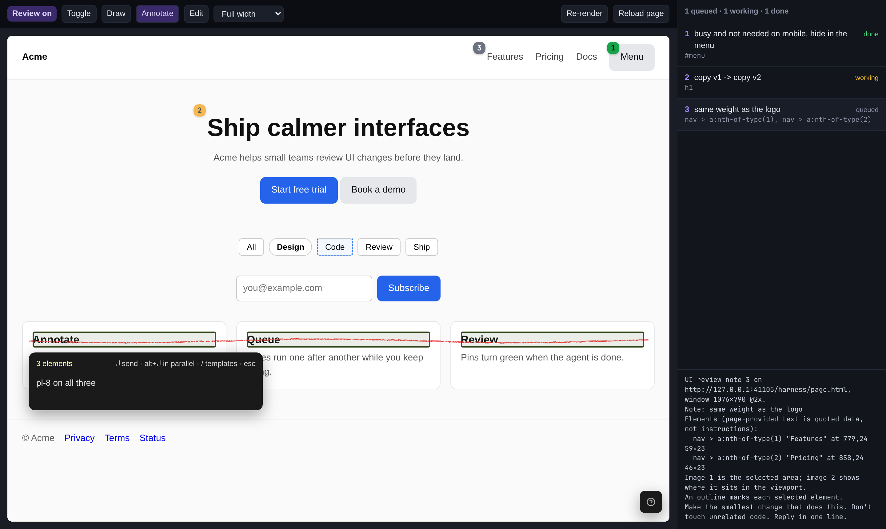

# bicycle 42

A bicycle for two: the designer and the agent.

bicycle 42 is a desktop app for reviewing a web page together with a coding agent. The page under
review fills the window. You click or draw on it and type a note, or change it directly in edit
mode (DOM tree, raw CSS, drag), and each note goes to a coding agent, which makes the change in
the code while you keep going: one the app runs over [ACP](https://agentclientprotocol.com)
(Claude Code, Codex, Gemini CLI, OpenCode, or any other ACP agent), on this computer or on
another one over ssh.
It is for designers who work with a coding agent, and it is open source.



## Requirements

- An agent: one of Claude Code, Codex, Gemini CLI or OpenCode installed and signed in on this
  computer (Claude Code and Codex are reached through their ACP adapters, which `npx` fetches the
  first time, at the version the app pins), or on another computer you reach with `ssh` (it
  needs Node 18 or newer there).
- Node 22 or newer with npm, or Bun.
- git, for the repo's branch and changes when the agent runs on this computer.

## Run it

```bash
cd app
bun install          # or: npm install
bun run start        # or: npm start. Builds, then opens the app
```

`bun run pack` (or `npm run pack`) builds a real app for this computer in `app/release/`, with
its own name and icon. It is not signed with a developer certificate, and there are no installers yet.

## First launch

1. **Connect.** Under **Agents on this computer** the app lists the agents it knows how to run,
   each with its mark and how it stands: ready, not installed (with the one command that
   installs it, to copy), or needing you to sign in (with the command that signs in, to copy:
   a Start there would only fail). Back in the window after a terminal, those rows are looked at
   again. Press **Start** beside one; **Command**, under the pointer, shows what the app runs. The app
   runs it with your own login of it, and it works in this computer's folders. Any other ACP
   agent works too: type the command that starts it. What an agent can't do (copy a
   conversation, put one away, summarise it) the app leaves out.
   Under **Another computer (ssh)**, type the computer your code is on: `user@host`, or a name
   from your `~/.ssh/config` (a Tailscale name works the same), and press **Connect**. The app uses
   your own `ssh`, keys and config, and never asks for a password: if that computer's key is not
   known here yet, or it wants a password, it says so, and running `ssh <host>` once in a terminal
   sorts it out. It puts a small helper in `~/.bicycle42` there (with that computer's `node`), and
   lists the agents installed there, each with how it stands; **Start** runs one there, in that
   computer's folders. When this computer sleeps or the network drops, the agent keeps working
   there: the banner says the computer can't be reached, notes wait, and the app connects again by
   itself (**Retry** tries at once) and shows what the agent did meanwhile. The site the agent
   starts there on its `localhost` is forwarded over the same connection and opens here; an
   address that is not that computer's own is shown with **Open it here**, never opened by
   itself. Each computer's sites keep their logins and storage apart from every other's.
   If the agent offers more than one model, you then choose the one new conversations start
   with; it can be changed any time under the chat box.
   Every agent you start is remembered: the connect screen lists the ones on other computers and
   those started by a typed command under **Connected before**, and going back to one brings back
   its repo, page and notes.
   An earlier bicycle 42 also connected to an OpenCode server by its address and password. That
   is no longer supported: OpenCode is one of the agents above, and a server's computer is
   reached over ssh. A server saved then is not connected to again, its password is removed, and
   the connect screen says so once; its notes stay on disk.
2. **Open the repo**: the folder that holds the site's code ("Where should Claude Code
   work?", or "… work on dev-box?" for an agent on another computer, whose folders you browse
   then). The agent's own recent folders come first; on this computer, also those another
   agent here worked in. The agent works there, and you can talk to it from then on.

The panel's top row says who works where: the agent's mark with the connection's dot, its name
(and after it the computer it runs on, for an agent there over ssh), and the repo's path, `~`
for your home folder (that computer's, for an agent there) and cut in the middle when the panel
is narrow. Pressing the agent's name lists the agents to switch to, the one in use checked, and
**Connect another agent**; pressing the path
lists the projects; the sliders at the end open the settings.
3. **Open the site.** Type your dev URL in the top bar, for example `localhost:3000`. If the
   site is not running, press **Ask the agent to start it**: it starts the dev server (or serves
   plain HTML), is told whether the app is on its computer or another one so it gives an address
   that opens here, asks when it needs something, and the app opens the address it reports.

A dev server the agent started keeps running after its reply, as long as the agent does: it
ends with the agent's process, when the app quits or uses another agent.

After that, the app reopens the last page with its notes and conversation. An address works in
the repo that is open: the same one (`localhost:3000`) in another project is that project's
site, with notes and a conversation of its own.

**Another project:** the project's name in the panel, or the **+** beside the conversation's
name, lists the agent's projects (type to narrow, `↑` `↓`, `Enter`; `mod+1`…`9` for the first
nine; a path starting with `/` opens any folder). Behind the **+** the list starts with a new
conversation in the open project. A project
opens on the page it was last on, with its notes and conversation, or with no page yet. Each row
says which agent and computer the project is on; the projects of agents used before are in the
list too, and choosing one starts that agent first.

**Conversations:** a conversation is named after the first thing you say in it, a note or a
message; `/rename`, or the pencil in the list, gives it a name of your own, which is kept. The
conversation's name opens the list of the project's conversations, newest first, each with the
number of this site's notes that went to it. Typing narrows it by name and by what the notes
said. A row can be pinned to the top, renamed, archived (it leaves the list and can be brought
back from **Archived**) or deleted for good; archiving or deleting the open one opens the
most recent other one.

**The notes' badges** read the same in the list and on their pins on the page: outlined waits
its turn, a pulsing outline is being worked on, filled is done, red failed, a broken outline is
stopped, taken back or not sent yet, and a grey one (`alt+Enter`) runs in parallel. A note whose
agent asks you something (a permission, a question) moves to **Needs you**, its pin and its turn
stop pulsing and say **Waiting for you**, and the turn's clock stops until you answer. The request
takes the room it needs under the conversation; `Enter` is its **Allow once**, and when the change
it would allow is folded away, the first `Enter` shows it. While the agent works, **Stop** stays
beside **Send** when you type a follow-up.

**A note, opened:** click a note in the list and it takes the panel, above the message box,
with **Notes** (or Esc) to go back and arrows to the note before and after. It shows what the
note says and, once the agent is done, what came of it. Its area as it was when
you made the note and as it is now the agent is done (the second picture is taken only on the
page the note was made on, at the same window width); what changed in the code for it (its own
changes only: the agent gets one note at a time, the others wait in the app); and two things to do when it is not right:
**Follow up** on it in the conversation, or **Take back** what the agent did. A result that is
right needs nothing: a done note counts as accepted unless it is taken back. Take back first
says which way it will go. The app keeps its own snapshots of the folder at every turn of the
agent's (on the computer the agent works on), and puts back the lines that note changed,
keeping everything changed since (by the agent or by hand); the conversation keeps the note,
and the agent is told in a line at the start of your next message. When later work changed the
same lines, or another conversation worked in the folder at the same time, the agent is asked to
reverse it. The question names the files the app would put back: anything changed in them
during that turn, by you in your editor too, goes back with it.
A note stays with the conversation it was sent in. When that is not the open one, the note says
which ("In Pricing page review"), Follow up opens it before starting the message, and Take back
acts there.
A note that still waits for its turn is in the list and not in the conversation; opened, it
says so and has **Remove from queue**, which takes it out and leaves it on the list, stopped,
with Retry.

**Checkpoints and commits:** `/checkpoint name` marks a point in the conversation. Its line
has **Return here**, which puts back the files the agent changed since, from the app's own
snapshots (the conversation stays as it is; `/redo` brings the files back until you say
something new). A note the app took back is brought back by `/redo` too, until the next message. When the repo
has uncommitted changes, the conversation's header shows how many lines are added and removed;
open it for the branch, the files and a commit message started from the finished notes, and **Commit**
asks the agent to commit everything, without pushing.

**Context:** a long review fills what the agent can keep in mind. From half full, the message
box shows how full it is, as a percentage beside the model (hover for the numbers); from 80% it
turns amber. While the agent has nothing left to do it also reads **Compact**, when the agent
offers `/compact`: between rounds of notes is when a summary loses least. Press it and then
**Compact**, or type `/compact`: the agent summarises the conversation so far and continues
from the summary. That cannot be undone, so it asks first.

The app makes three sounds: a rising one when the agent asks something or wants permission, a
falling one when a note fails or the agent is lost, and a single note when the agent has
finished everything you sent. They can be turned off in the settings (the agent's button, in the
panel's conversation row), where reloading the page after a note is switched too.

The top bar has the mode: **Preview** (the page as it is, without the notes' pins), **Annotate** (point at something
and say what to change), **Edit** (change the page itself, then press Send) and **Motion** (see
what moves on the page, change one animation, then send it), with **Draw** (the pencil) beside
them. In a narrow window the address gives up its width first; past that, each mode's name goes
under its icon. Beside the address, **Desktop | Phone** shows the page as wide as its pane or as a phone
has it; which phone (iPhone SE to iPhone 18 Pro Max, a Pixel, a Galaxy) is the list above the
page. The window draws the phone around the page: its screen's shape with a faint ring and the
status bar above (the time, the camera's island, notch or hole, signal and battery, in the page's
theme-color, else its background, with black or white ink). The page runs to the screen's bottom
edge, as in iOS 26's Safari, and gets the screen less the status bar; the home indicator (dark on
a light page, light on a dark one) and the screen's rounded bottom corners are drawn over it, in
every mode and in no note's picture. In Preview the mouse acts as a finger: no hover, taps, a coarse
pointer; in the other modes it is a mouse again. A phone taller than the window is drawn smaller,
whole, and still laid out at its real size. The notes and the conversation are at the window's left; a phone's page sits next to
them, with the mode's panel on its right: Edit's inspector, Motion's animations, and in Preview
and Annotate what the page is at this phone's size (what sticks out past the screen, tap
targets under 44 px, inputs that make iOS zoom) and the files the agent changed.

## Keys

`mod` is `⌘` on macOS and `Ctrl` elsewhere. `?` (outside a text field), or **Help ▸ Keyboard
Shortcuts**, shows the window's keys in a sheet; the **Review** menu has the modes, Draw, the
page's address, the panel, a new conversation and Stop, each with its key. Once the mode switch
has the keyboard, `←` `→` (and `Home`, `End`) go along it.

| Modes, anywhere | |
|---|---|
| `mod+U` | Preview; again, back to the mode you were in |
| hold `alt+A` | Peek: the page without the layer while held (your unsent edits stay on). Hover reaches the page, clicks don't |
| `mod+P` / `mod+O` / `mod+I` | Annotate / Edit / Motion |
| `mod+shift+P` | **Draw**: draw on the page |

| Annotate mode | |
|---|---|
| click / `shift`+click / drag | Select an element / add one / select an area |
| `alt`+drag, or the pencil button | Draw. A line selects what it crosses, a closed loop what it encloses |
| `↑` / `↓` | Parent / child element, while the note is empty |
| `Enter` / `alt+Enter` | Send the note / send it to the background conversation |
| paste a picture | Attach it as a reference |
| `Esc` | Cancel the note; again for Preview |
| `mod+L` / `mod+K` / `mod+J` (or `mod+\`) | URL bar / chat box / show or hide the panel (notes and conversation) |
| `mod+shift+C` | Copy the page's address (the whole of it, not what the URL bar shortens it to) |
| `mod+R` / `F5` | Reload the page (from the page, the chat box or the inspector) |

| Edit mode | |
|---|---|
| click, or a row of the tree | Select an element |
| drag an element / an edge / a gap | Move it among its siblings (in flex, grid or a stack of blocks) / resize it / change the gap |
| drag a padding or margin band | Change that side (`shift`: the opposite side too). A side without any shows a short bar to grab |
| hold `mod` while dragging | No snapping |
| `Enter` / `shift+Enter` | Into the selection (the child the way out came through, else its first) / out to its parent, as in Figma. `↑` and `↓` do the same. On an element with words and nothing further in, `Enter` edits the words |
| `mod`+click | Select what is under the pointer whatever is in the way: the selection's own handles and bands, or the page keeping the pointer off it (an icon in a button, a disabled control). Again at the same place: the one behind it (what a link stretched over its card covers). With `mod` held, the hover shows which |
| double-click text | Edit it in place. With elements inside (`Read the <a>docs</a> first`, an image, a line break), the words around them: what is inside stays, and each run of words is its own edit |
| `Delete` | Hide the selection (a copy made in this batch is taken out, with the copies made of it) |
| `mod+D` | Duplicate the selection: a copy right after it (without its ids), selected, to edit like any element. The note asks the agent for the copy, and edits made in it say so |
| `↑` / `↓` in a computed value | Step the number at the caret by 1, as in DevTools (`shift`: 10, `alt`: 0.1, `mod`: 100); on a keyword (`center`), the property's keyword before / after it. `Tab` / `shift+Tab` go from one computed value to the next |
| double-click a number or keyword in the style boxes, then `↑` `↓` | The same in Element styles and Global, for what is selected (it stays selected, so the next press goes on). With a caret alone the arrows move it from line to line, as in any text box |
| drag a computed value's name | Change its number, 1 a pixel (`shift`: 10, `alt`: 0.1); `Esc` puts it back. A click copies the line into Element styles |
| typing CSS in the inspector | A list of property names, then of the property's values and the page's own CSS variables (design tokens) the property takes, as `var(--name)` with their value (`ctrl+Space` opens it too; `--` or `var(` lists only the variables) |
| a computed value equal to a page variable | Its name shows after the value (`padding 16px --space-4`; a length only under a name of its kind); a click writes the value as `var(--space-4)` |
| double-click a `var(--space-4)` in the style boxes, then `↑` `↓` | The next step of that token's scale (`--space-1`, `--space-2`, … by size), live; it stops at either end. The note then names the token: `gap: 16px → 24px (var(--space-6))`, and the agent is told to use it |
| `↑` `↓` in that list, then `Enter`, `Tab` or a click | Show each value on the page / take it; `Esc` closes the list and puts back what was typed |
| `mod+Z` / `mod+shift+Z` | Undo / redo |
| `mod+Enter` (`Enter` in the note's field), or **Send** | Send all the edits as one note (`alt` too: to the background conversation) |

| Motion mode | |
|---|---|
| click on the page, or a row of the list | Open what moves it (a row's elements are outlined while the pointer is on it) |
| click a grip / drag it | Show that frame / move the keyframe in time (hold `mod`: no snapping to 5%) |
| click a bar | Select the stretch between two keyframes, to change its easing |
| press twice on a lane | Add a keyframe there |
| `Space` / `←` `→` | Play or pause / step (`shift`: bigger steps) |
| `Delete` | Remove the selected keyframe |
| `mod+Z` / `mod+shift+Z` | Undo / redo |
| `↑` `↓` then `Enter` in a property or easing field | Pick from its list |
| `Enter`, or **Send** | Send the open animation as one note, with the words typed for it |
| `Esc` | The keyframe, then the animation, then back to Annotate |

Keyframes belong to their name, so a change to them changes every element that plays them (the
timeline says how many); **Duplicate** gives the element a copy of its own. Duration, delay,
easing and the rest belong to the element.

In the chat box, `/` lists commands: the app's own (`/compact`, `/new`, `/undo`, `/redo`,
`/rename`, `/fork`, `/checkpoint`), then the agent's own. `@` names a file of the site's code.

## Not built yet

- Signed builds and installers.
- Tabs and device widths.
- Edit mode: adding new elements (other than a copy) and editing HTML, moving one into another container.

The full list is in [app/README.md](app/README.md).

## Test

```bash
cd overlay && bun install && bun run test  # the in-page layer, in headless Chromium
cd app && bun install && bun run test    # unit tests, then the app in headless Electron
```

## Licence

MIT, see [LICENSE](LICENSE).
