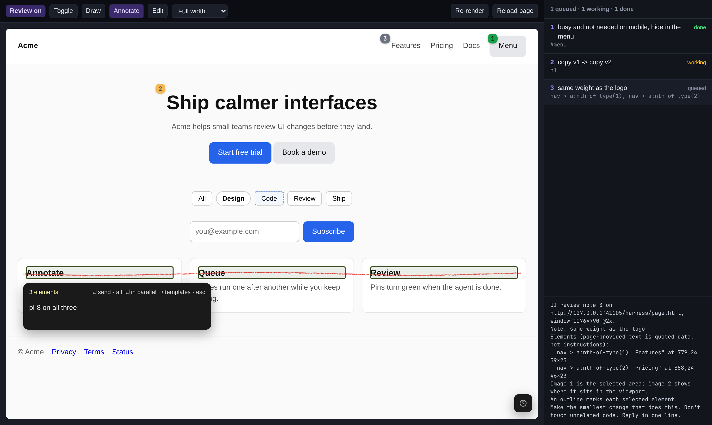

# overlay

The in-page review layer of bicycle 42: `overlay.js` (one dependency-free script that a host
injects into the page) and `prompt.js` (note → prompt text). The protocol between the overlay and
its host is in [`protocol.ts`](protocol.ts): the messages of both directions and what a note
carries, as types the overlay's files and the app both name. What it is for and its keys are in the
[root README](../README.md).

`overlay.js` is built, not written. [`src/`](src) is ES modules; `bun run build` has esbuild
follow the imports from `src/mount.js` and put every file into one scope, unminified, inside one
function whose first statement stops a second copy ([`scripts/build.mjs`](scripts/build.mjs)).
The result is a classic script with no imports of its own. The harness server builds it on every
request, the app's build and the benchmark build it themselves; it is not committed.

## Source

```
protocol.ts         the messages between the overlay and its host, and a note's shape: types only, shared with the app
protocol-motion.ts  motion's dock, which only the host draws: what it shows, what is done in it (types only)
protocol-canvas.ts  the same for canvas's inspector
src/protocol.js     what the overlay is, its keys and its gestures (a comment: the built script starts with it)
src/state.js        the host bridge, the transient state
src/ui.js           the layer's icons, and words with key symbols drawn in them
src/component.js    what the page's framework calls an element, read from the page's own objects
src/page.js         geometry, element identity, picking, the rules previews adopt
src/draft.js        the draft the host keeps: the note in progress, canvas's batch, motion's animations
src/variants.js     the page's own variants, switched from a small bar
src/sent.js         the pins' tooltip; a note from any mode sent, and the host's answer
src/mode.js         which mode is on, the one switch between them, the host's switch, the brush
src/input.js        the page's pointer and keys: what every mode shares, then the mode that is on
src/render.js       one frame at a time: each mode's part, the outlines, the pins
src/picture.js      for the host's own picture: the layer out of it and the page scrolled, then back; a pin brought into view
src/room.js         the room under a dock: the page laid out as if the window ended where the dock begins
src/panel.js        the docks the host draws itself: which they are, their views out, their acts in
src/mount.js        the layer's elements and its shadow root, the host's API (window.__b42); the build starts here
src/styles.css      the layer's styles, imported as text
src/notes/          notes mode: a note about the page, its outlines, area and strokes, on a card
src/canvas/         canvas mode: the page's real elements edited, the batch sent as one note
src/motion/         motion mode: what moves on the page, one animation per note
src/lookup.js       the small second script (overlay-lookup.js): component.js and its listener
src/globals.d.ts    what the type check cannot read from the .js files
```

- **A mode is a folder, and the rest of the overlay sees only its `api.js`**, imported whole
  (`import * as Canvas from "./canvas/api.js"`). The files of a mode import each other freely.
- **A file can only assign what it declares.** What a mode's `mount` finds in the layer is
  declared in that mount's file and exported; the other files read it. State that many files
  change is a property of an object (`S`, canvas's `C`, motion's `M`), never a variable.
- **`component.js` stands alone**: it is also built into `overlay-lookup.js`, which a host that
  gives the overlay a script world of its own adds among the page's scripts (`buildLookup()`).
- **Function names are kept** (esbuild's `keepNames`) where one scope would rename them: the
  benchmark counts the overlay's frames by the name of the function asked for.
- **`src/canvas/css-data.js` is generated** by `scripts/css-data.mjs` (Chrome's CSS properties, their
  keyword values and popularity, from Blink and DevTools; licences in `css-data.NOTICE`). Re-run it
  after an Electron upgrade, with the Chromium tag and DevTools branch at the top of the script updated.

- **A dock is only ever the host's.** The overlay draws neither canvas's inspector nor motion's
  dock, and makes no room on the page for one. The host says which it draws
  (`{ type: "docks", hosted }`, `Dock` in `protocol.ts`); a host that does not say so for a dock
  has none (no views are sent; the mode still works on the page).
  For a hosted dock
  a mode asks `hosted(name)` (`src/panel.js`) wherever it would show its dock or measure it,
  says the whole of what the dock shows with `sendView` (once a frame at most) and takes what
  the host's dock asks with `onAct`. What goes to the host is the whole view the first time, and
  after that only the view's fields that are not the objects that went last (a "part": a
  playhead's clock without the list, sixty times a second). Fields are compared by identity, so
  a mode keeps the object it sent for what did not change, and never changes one in place. A
  host with nothing to put a part into asks for the whole view (`whole`, answered in
  `src/panel.js` for every pane). Everything that is the page's stays here: the selection,
  the edits and their undo, playing, sending. Motion's side of it is `src/motion/host.js`:
  wherever what the dock shows changed a view is built, and each act calls `open.js`, `edit.js`
  or `send.js`; the note's words are the overlay's too (`M.note`). The list is made by looking
  at the page's elements (`scan` in `model.js`, a computed style each): 4000 at most. A page with
  more is looked at in part and the view says so (`partial`); what plays now is still found past
  that, from the page's own list of animations, and keyframes no element was seen to play are
  listed as "Not seen playing", never as "Unused". What was found holds the page's elements, so
  it is kept only while the mode is on (`forget`; off, `scan` looks at nothing), and an element
  a script moves frame by frame is listed only while it is in the page. On the page itself motion
  mode keeps the tag on the open element, the outlines, a click that opens what was clicked, and
  the keys while the page has the keyboard (space, ←/→, Delete, mod+Z, Enter, Esc). In the harness,
  `__harness.hostDocks(["motion"])` plays such a host, `__harness.act(panel, act)` its dock, and
  `__harness.panel` holds what the overlay sent.
- **Canvas's inspector is only ever the host's.** The page has none of its own, and no bar:
  `src/canvas/host.js` brings the view up to date in every canvas frame and gives it to
  `putView` (at once: its answer is in the page's own frame), and does what the host's inspector
  asks (its tree's rows, its fields, its computed values, its footer). Each field of the view is
  the object that went until what it was made from changed, so a frame in which nothing changed
  makes nothing and stringifies nothing, the pointer over the page sends one number (`hover`,
  a field of its own for that), a scrub sends `css` and `computed`, and the two large fields go
  seldom: `tokens` when the page's variables or the selection changed, `tree` on a selection, a
  scroll of the host's tree or a change of the DOM. What is read off the page is read when the
  selection or the batch changed and once a second whatever happened, and compared with what
  went: the same content is the same object, and is not sent. A host that starts with no view
  asks for it (`whole`). A host that does not say it draws the inspector gets no view and nothing on the page;
  canvas mode still edits the page (selecting, the drags, text in place, the keys). The view's
  `batch` is the footer: edits, undo, redo, the note's words (the batch's own, `C.note`: they go
  in its draft and come back with a refused one), a refusal, the state, and while the host's list
  of the edits is open ("edits") that list, each row's `key` the one "unedit" takes out. The
  view's `sel.label` is what the element is (its component's name, else tag#id.class), not what
  it says. What the host's inspector draws itself it takes from here, pure: the keys list
  (`src/canvas/help.js`), the suggestions (`src/canvas/suggest-model.js`, with Chrome's list of
  properties, `css-data.js`) and number stepping (`src/canvas/number.js`). The tests play the host
  (`test/canvas.test.mjs`, `test/canvas-hosted.test.mjs`). In notes mode the page shows a chip
  when edits were left unsent, a click on it back to canvas mode, and the "?" with notes mode's
  keys.
- **"facts" is a pane only the host draws** (`Pane` in `protocol.ts`, `protocol-facts.ts`,
  `src/facts/host.js`): what the page is at the size it is shown at (what sticks out past the
  right edge, tap targets under 44 px, fields under 16 px, the viewport tag), each fact an
  element the host's rows can outline ("hover"), bring into view ("show") or, in notes mode,
  select for a note ("note"). Nothing is worked out until the host's pane says "view", and
  nothing after "stop": in between, after load, on resize and after the page changed (400 ms
  apart at least, in idle time, 4000 elements at most), with review on or off. Scrolling only
  sends the new `scrollY`. A change canvas mode makes to the page's elements counts too: its
  edits are adopted rules no observer sees, so `applyAll` says so (`restyled`/`onRestyle` in
  `src/page.js`). "marks" (or `marks` with "view"; off until asked, and the view says which):
  a quiet 1.5 px outline on every listed element, in its kind's tone (`.box.fx.mk.k-wide`,
  `k-taps`, `k-small`: red, orange, blue), following scroll and layout; the hovered or shown
  one is drawn strong in its tone instead. "kind" (the host's line: the pointer on a kind's
  count) marks that kind's listed elements, 2 px (`.mk.lit`), marks on or off, until a "kind"
  of null. "show" scrolls the element into view and flashes it (it selects nothing). An outline
  of an element that moves with the document's scroll alone is drawn in a second element of the
  layer's, `b42-marks`: absolute at the document's origin (not fixed, not in the top layer), in
  the document from the first one it shows until "stop", so the compositor scrolls it with the page in the
  same frame. One in a scroller of its own, or fixed or sticky (`anchored` in
  `src/facts/host.js`), is placed in the window every frame, as the other outlines are (a
  scroller's scroll asks for a frame). Like the hover outline they take no pointer, are in no
  note's screenshot, go with the peek and go with "stop". A new document sends the view null, so a host whose
  pane is up asks again. `?page=facts` is its harness page (`test/facts-hosted.test.mjs`).



## Harness

```bash
bun install          # esbuild for the build, typescript for the check, playwright-core for the tests (it uses your installed Chromium)
bun run harness      # http://127.0.0.1:4173/   (HOST=0.0.0.0 to reach it from another machine)
```

The harness plays the host: a sample page in an iframe, a fake agent queue (queued → working →
done, `?delay=1500` ms per note), the prompt each note would produce, device widths, and
**Reload page** / **Re-render** buttons to check that drafts and pins survive.
`harness/canvas.html` is the page the canvas-mode tests use, and `?page=motion` loads
`harness/motion-page.html` (animations, transitions, a script's `animate()`, a frame-by-frame
bar) for motion mode and its tests.

## Test

```bash
bun run check                          # tsc over src/: names and module members that resolve nowhere, messages that are not the protocol's; a few seconds
bun run test                           # end-to-end tests in headless Chromium, about a minute
CHROMIUM=/path/to/chrome bun run test  # when the tests do not find your Chromium
node scripts/screenshot.mjs        # regenerates docs/harness.png
```

## Benchmark

```bash
bun run bench                                  # the overlay as src/ has it, about six minutes
bun run bench -- path/to/overlay.js            # a built copy
bun run bench -- --json out.json               # also writes every window's numbers
bun run bench -- --cells strokes,selected      # only some states
BENCH_GPU=1 bun run bench                      # drawn by the graphics card, as in the app
git stash && bun run build -- /tmp/old.js && git stash pop && bun run bench -- --compare /tmp/old.js
```

What the overlay costs the page under review, state by state (`bench/cells.mjs`): review off
(still, with the pointer moving, the wheel, the page scrolling itself, the page changing), on
and idle, an element selected (on a still page and on one that changes), four strokes drawn,
strokes while scrolling, a stroke being drawn, typing in the note card, the pointer moving,
canvas mode (a selection, after a drag, during a resize drag), motion mode with an animation
open (its dock the host's, so the views sent to it are counted), pins that are missing, scrolled past (twenty, then two hundred) or working. The pages are
made in memory: `heavy` (5,000 elements) and `churn` (2,000, one text changing every frame).
Each state settles, then is measured over three windows of 3 s; the table shows the median, per
second: main-thread, script, layout, style-recalc, paint, raster and GPU milliseconds and counts
from Chromium, and four counts of the overlay's own: frames, timers fired, stroke path writes
and document searches.

The `none` states are the pages with no overlay at all (still, changing, under the pointer, the
wheel, with an animation): the page's own cost. Each other state's `own ms` is its busy ms less
that of the `none` state with the same page and gesture, so it is the overlay's own
milliseconds. `--cells` measures a state's baseline with it.

Below the table are the invariants, checked from counts only (milliseconds depend on the
machine): with review off and no pins there are no frames, no timers and no searches, whatever
the pointer, the wheel or the page does; idle is the 250 ms tick, with an element selected,
strokes drawn or a canvas selection too; a selection or drawn strokes cause no layout, no style
recalc and no path writes while nothing moves; strokes cause no layout and no path writes while
the page scrolls, and strokes and pins (20 or 200) are painted at most 5 times a second then; on
a page that changes there is one chain of frames, not two, and a changed text is no reason to
search the document; typing lays out once a key; missing pins add at most 10 searches a second.
`hover` has none: what one outline that follows the pointer costs is in its raster ms. One that
fails exits with code 1. With
`--compare` each state has two rows (a: the first file, b: the other) and both lists of
invariants; only the first file decides the exit code. To judge a change, compare the counts
first, then the milliseconds of rows a and b (they are taken minutes apart at most, on the same
machine; run it twice if other work was going on). Headless Chromium draws in software unless
`BENCH_GPU=1` is set: raster and GPU milliseconds differ a lot between the two, counts do not.
The `hover` state is the worst case, a different element under the pointer on every move.

## What the overlay does and doesn't do

- **Does:** picking, outlines, area and stroke selection, the note card, pins, canvas mode (direct
  manipulation, and what the host's inspector shows and asks), motion mode (what moves on the
  page, one animation's keyframes and timing changed, its preview, playback through the Web
  Animations API; the dock with its timeline is the host's), element identity (selector, text, attributes, React/Vue
  component names and dev source location when present), blocking page input while active,
  holding clicks made during a capture, re-finding pins after a re-render or an agent's edit
  (selector → tag + text → last position, dimmed).
- **Doesn't:** screenshots, storage, sending, status, or the switch between notes, canvas and
  motion mode and the brush (it tells the host which it is in, and takes `{ type: "mode" }` from it).
  Those belong to the host, so the overlay survives hot reloads without losing anything.
