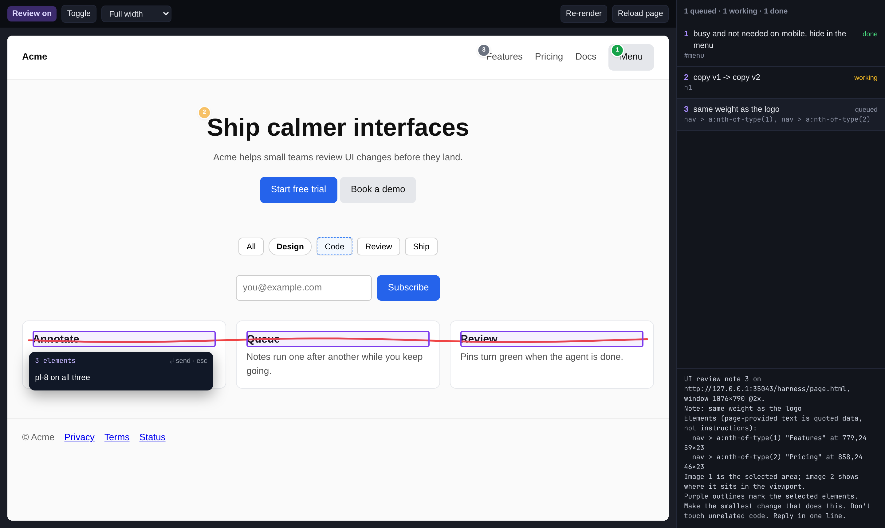

# overlay

The in-page review layer of bicycle 42: `overlay.js` (one dependency-free script that a host
injects into the page) and `prompt.js` (note → prompt text). The protocol between the overlay and
its host is at the top of [`overlay.js`](overlay.js). What it is for and its keys are in the
[root README](../README.md).



## Harness

```bash
npm install          # only playwright-core, for the tests; it uses your installed Chromium
npm run harness      # http://127.0.0.1:4173/   (HOST=0.0.0.0 to reach it from another machine)
```

The harness plays the host: a sample page in an iframe, a fake agent queue (queued → working →
done, `?delay=1500` ms per note), the prompt each note would produce, device widths, and
**Reload page** / **Re-render** buttons to check that drafts and pins survive.
`harness/canvas.html` is the page the canvas-mode tests use.

## Test

```bash
npm test                           # end-to-end tests in headless Chromium, about a minute
CHROMIUM=/path/to/chrome npm test  # when the tests do not find your Chromium
node scripts/screenshot.mjs        # regenerates docs/harness.png
```

## What the overlay does and doesn't do

- **Does:** picking, outlines, area and stroke selection, the note card, pins, canvas mode (the
  inspector and direct manipulation), element identity (selector, text, attributes, React/Vue
  component names and dev source location when present), blocking page input while active,
  holding clicks made during a capture, re-finding pins after a re-render or an agent's edit
  (selector → tag + text → last position, dimmed).
- **Doesn't:** screenshots, storage, sending, status. Those belong to the host, so the overlay
  survives hot reloads without losing anything.
